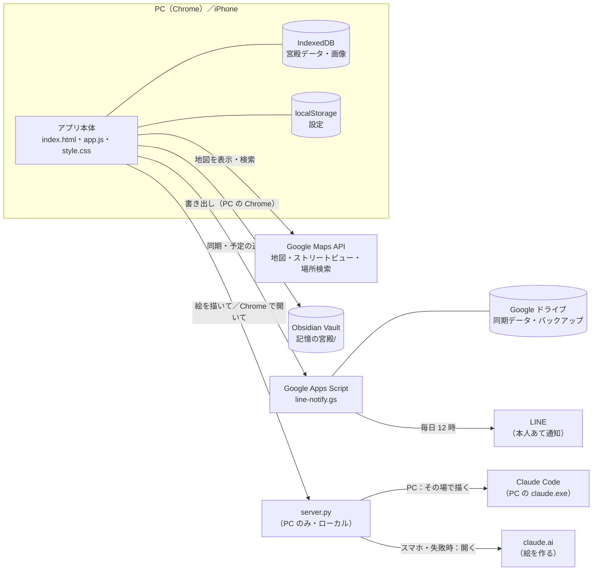
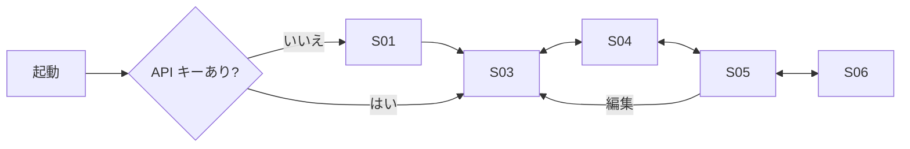

# 沖縄 記憶の宮殿 — 基本設計書

| 項目 | 内容 |
|---|---|
| 版 | 1.0（2026-11-11 作成。コミット 4c0a577 時点のコードから起こした） |
| 対象 | `loci-okinawa` リポジトリ一式（アプリ本体・使い方ページ・ローカルサーバー・Apps Script） |
| 関連 | 内部の作りは [詳細設計書](detailed-design.md)、操作方法は [help.html](../help.html)、開発メモは [CLAUDE.md](../CLAUDE.md) |

> 機能を変えたら、この設計書・詳細設計書・help.html の 3 つを一緒に直す。

---

## 1. 目的

Google ストリートビューで沖縄の景色を歩き、**場所法（記憶の宮殿）** で覚えたいものを景色に「置いて」、忘却曲線に合わせて復習するための**自分専用**の Web アプリ。

いまの主な使い道：英語のよく使うフレーズ（チャンク）を、いつもの散歩コースに置いて覚える。

## 2. 方針・制約

| # | 方針 | 理由 |
|---|---|---|
| 1 | **無料で運用する** | Google Maps の無料枠＋1 日の割り当て上限で、課金されないようにする。有料のものを足すときは事前に相談 |
| 2 | 範囲は**沖縄だけ** | 沖縄の外には移動できない（緯度 24.0〜27.2、経度 122.9〜131.4） |
| 3 | 利用者は**本人だけ** | ログイン機能は持たない。データは本人の端末と本人の Google ドライブだけに置く |
| 4 | **ストリートビューの画像は保存しない** | Google の規約。保存するのはパノラマ ID・位置・向き・ズームだけ |
| 5 | Obsidian へは**書き出すだけ**（一方通行） | Obsidian で書き換えても、アプリには戻らない |
| 6 | AI 画像は**追加料金なし**で作る | PC では、この PC の Claude Code（本人の Claude のプランの範囲）にアプリの中で描いてもらう（2026-11-11〜）。スマホ・ネット版は claude.ai を開いて作って貼る。有料の画像 API は使わない |
| 7 | **毎日の復習を強制しない** | 復習と通知は忘却曲線のポイントの日だけ。連続日数の表示はしない（本人の希望） |

## 3. システム構成

| 構成要素 | 役割 | 置き場所 |
|---|---|---|
| アプリ本体 | 画面・操作・データ保存のすべて。ビルドなしの素の HTML／CSS／JavaScript | GitHub Pages（https://hungryharu.github.io/loci-okinawa/）と、PC のローカル（http://localhost:8000） |
| help.html | 使い方ページ | 同上 |
| server.py | PC 用のローカルサーバー。ファイルを配るほか、Claude Code に絵を描かせる役と、claude.ai を Chrome で開く役 | PC（127.0.0.1:8000） |
| start-app.ps1 | デスクトップのアイコンから server.py を起動し、Chrome のアプリ表示で開く | PC |
| line-notify.gs | クラウド連携（PC とスマホの同期・毎日のバックアップ・LINE 通知） | 本人の Google アカウントの Apps Script |

## 4. 機能一覧

| ID | 機能 | 概要 |
|---|---|---|
| F01 | API キーの設定 | 初回だけ Google Maps の API キーを入れる。キーは端末内に保存（コードには書かない） |
| F02 | 場所を探す | 地図をクリック／ストリートビューの矢印で歩く／場所の名前で検索（Enter のときだけ検索） |
| F03 | 場所に置く（作成） | 今の景色（位置・向き・ズーム）に「覚えること」などを置く |
| F04 | 景色に描く | ペンで落書き・付箋・画像を貼る。画像は大きさと位置を変えられる |
| F05 | イメージを絵にする | PC：ボタン 1 つで Claude Code がアプリの中で絵（SVG）を描き、そのまま貼る。「絵への注文」を書ける。描いたあとは「さっきの絵を、この注文で直す」もできる。スマホ・ネット版：指示文をコピーして claude.ai を開き、できた絵を貼る |
| F06 | 書きかけの保存 | 「置く」前の入力と落書きを残す。アプリを閉じても消えない |
| F07 | 復習 | ルートの順に景色を出し、思い出す → 答えを見る → 覚えてた／忘れたを記録 |
| F08 | 次の復習日を決める | 間隔反復（1・3・7・14・30・60・120 日）。近い日の復習はまとめる |
| F09 | 一覧 | 場所の確認・編集・並べ替え・削除 |
| F10 | 記録 | 次の復習日、覚え具合（4 段階）、12 週間の復習カレンダー |
| F11 | 宮殿の管理 | 宮殿（ルート）の追加・切り替え・名前の変更・削除 |
| F12 | バックアップ | JSON ファイルに保存／読み込み（画像も含む） |
| F13 | クラウド同期 | PC とスマホで同じデータを使う（本人の Google ドライブ経由） |
| F14 | クラウドのバックアップから戻す | 毎日 12 時ごろのバックアップ（7 日分）から戻す |
| F15 | LINE 通知 | 毎日 12 時台、ポイントの日だけ、問題（景色のリンク）と答えを LINE に送る |
| F16 | Obsidian 書き出し | 宮殿ごとのノート・画像・データ全体を Vault に書き出す（PC の Chrome だけ） |
| F17 | 画面の色 | 自動／ライト／ダークを切り替え |
| F18 | 保存状況を見る | 宮殿・場所・画像の数、使っている容量などを表示 |

## 5. 画面一覧

1 つのページの中で、右側のパネル（スマホでは下）をタブで切り替える。

| ID | 画面 | 開き方 | 主な表示・操作 | 関係する機能 |
|---|---|---|---|---|
| S01 | API キーの設定 | 初回／メニュー「APIキーを変更」／キーが拒否されたとき | キー入力・保存 | F01 |
| S02 | 景色（ストリートビュー） | 常に左側（スマホでは上） | 景色・描き込み道具（✋✏️📝🖼⤡・色・太さ・戻す・全消し）・検索窓・小さな地図 | F02・F04 |
| S03 | 作成タブ | タブ「作成」 | 目印の名前・覚えること・日本語の問題・連想イメージ・「この場所に置く」・絵を作る | F03・F05・F06 |
| S04 | 復習タブ | タブ「復習」 | 今日の復習の数・始め方（今日／苦手／全部）・出題カード・答え・覚えてた／忘れた | F07・F08 |
| S05 | 一覧タブ | タブ「一覧」 | 番号・覚え具合・内容・見る／編集／↑↓／削除 | F09 |
| S06 | 記録タブ | タブ「記録」 | 次の復習日・覚え具合の帯・復習カレンダー | F10 |
| S07 | メニュー | 右上の「⋯」 | 画面の色・宮殿の名前変更／削除・バックアップ・保存状況・Obsidian 解除・クラウド連携・クラウドから戻す・API キー | F11〜F18 |
| S08 | 使い方 | 右上の「？」 | help.html を別タブで開く | — |

### 画面の流れ

## 6. データの概要

| データ | 中身 | 保存場所 |
|---|---|---|
| 宮殿データ（state） | 宮殿の一覧、各宮殿の場所（locus）、日ごとの復習の記録 | 端末の IndexedDB（同期を使うと Google ドライブの state.json にも） |
| 場所（locus） | パノラマ ID・位置・向き・ズーム、目印の名前、覚えること、日本語の問題、連想イメージ、描き込み、復習の成績と次の復習日 | 宮殿データの中 |
| 画像 | 貼った絵（384px に縮小、白い背景は透明に） | 端末の IndexedDB（同期を使うと Google ドライブの images/ にも） |
| 書きかけ | 「置く」前の入力と落書き | 端末の IndexedDB |
| 設定 | API キー・クラウド連携の URL・画面の色・問題を出すか など | 端末の localStorage |
| バックアップ | 毎日 12 時ごろの宮殿データ（7 日分） | Google ドライブの backups/ |
| Obsidian ノート | 宮殿ごとの .md（Spaced Repetition 形式のカード付き）・画像・_data.json | Vault の `記憶の宮殿/` |

※ 項目の細かい定義は詳細設計書の「4. データ定義」。

## 7. 外部とのつながり

| 相手 | 使うもの | 何をするか | 費用 |
|---|---|---|---|
| Google Maps Platform | Maps JavaScript API（地図・ストリートビュー）、Places API (New) の Text Search | 景色・地図の表示、場所の検索 | 無料枠の中。1 日の割り当て上限で止める |
| Google Apps Script | 本人のウェブアプリ（URL＋合言葉） | 同期・バックアップ・LINE 通知 | 無料 |
| Google ドライブ | 「沖縄 記憶の宮殿（同期データ）」フォルダ | 同期データとバックアップの保管 | 無料（本人の容量） |
| LINE Messaging API | 本人あてのプッシュ通知 | 復習のお知らせ | 無料枠の中 |
| Obsidian | File System Access API（PC の Chrome） | Vault にノートを書き出す | 無料 |
| Claude Code（PC） | server.py から `claude.exe -p` を呼ぶ（道具なし・Sonnet） | 連想イメージの絵（SVG）をアプリの中で描く | 本人のプランの中（追加料金なし） |
| claude.ai | ブラウザで開くだけ | スマホ・ネット版で絵を作ってもらう | 本人のプランの中 |

## 8. 非機能

| 観点 | 決めていること |
|---|---|
| 動く環境 | PC の Chrome（すべての機能）、iPhone のホーム画面アプリ（Obsidian 書き出し以外）。ブラウザは Chrome に統一 |
| 費用 | 0 円で運用。API キーはウェブサイト制限（localhost と GitHub Pages）と API 制限をかける |
| データの安全 | データは本人の端末・本人の Google ドライブだけ。同期の URL には合言葉が必要。API キーや合言葉はコードに書かない（リポジトリは公開のため） |
| データを失わない工夫 | 自動保存／ブラウザに「消さないで」とお願い（persist）／JSON バックアップ／クラウドの毎日のバックアップ 7 日分／同期で読み込む直前の内容を 1 つ控える |
| 注意 | iPhone のホーム画面アプリは**消すとデータも消える**。入れ直す前にクラウド同期が済んでいるか確かめる |
| 使いやすさ | 日本語の平易な言葉。復習はキーボードでも操作できる（Enter で答え、1＝覚えてた、2＝忘れた） |
| 見た目 | 琉球デザイン（琉球藍・紅型風の模様・ミンサー織の帯・朱印風の番号）。ライト／ダーク対応 |
| 更新の反映 | CSS・JS を変えたら index.html の `?v=` を上げる（GitHub Pages は 10 分キャッシュ） |

## 9. 用語

| 用語 | 意味 |
|---|---|
| 宮殿 | 場所を順番に並べたルート 1 本（例：散歩コース） |
| 場所（locus） | 宮殿の中の 1 か所。景色 1 枚に、覚えること 1 つを置く |
| 連想イメージ | 場所と覚えることを結びつける、変で鮮やかな光景 |
| ポイントの日 | 忘却曲線で「そろそろ忘れかける」日。この日にだけ復習・通知する |
| 覚え具合 | 未復習／覚え中（連続正解 0〜2）／定着（3〜4）／長期記憶（5 以上） |
