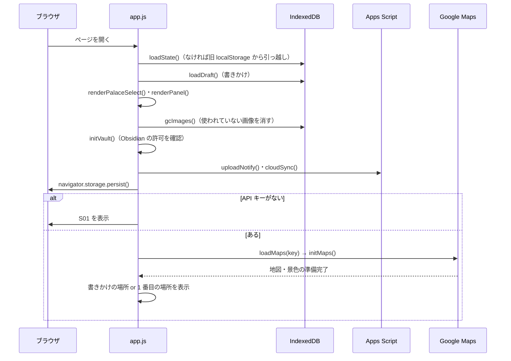
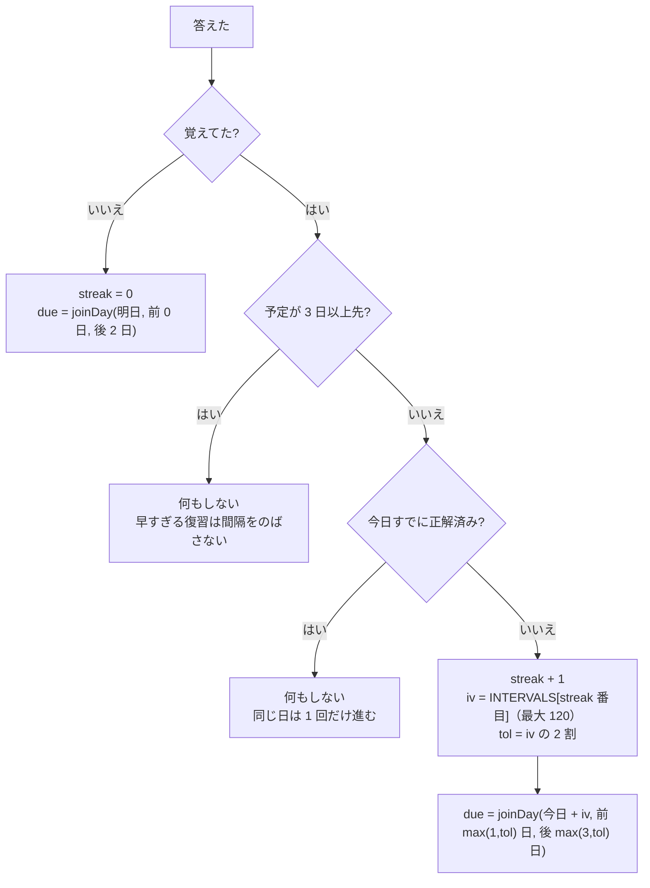

# 沖縄 記憶の宮殿 — 詳細設計書

| 項目 | 内容 |
|---|---|
| 版 | 1.0（2026-11-11 作成。コミット 4c0a577 時点のコードから起こした） |
| 前提 | [基本設計書](basic-design.md) の機能 ID（F01〜F18）・画面 ID（S01〜S08）を使う |

> 関数名は app.js（gas/line-notify.gs のものは末尾に `_` が付く）。行番号は変わるので書かない。探すときは関数名で検索する。

---

## 1. ファイル構成

| ファイル | 中身 |
|---|---|
| `index.html` | 画面の骨組み（S01・S02・タブ・メニュー）。head で画面の色を先に当てる |
| `app.js` | すべての処理（約 2,100 行・1 ファイル）。下の「2. app.js の区分け」の順に並んでいる |
| `style.css` | 見た目。色は `:root` のトークンだけで決める（ライト／`prefers-color-scheme: dark`／`[data-theme="dark"]` の 3 か所に同じ名前で） |
| `help.html` | 使い方ページ |
| `server.py` | ローカルサーバー（静的配信＋`POST /open-chrome`＋`POST /draw`） |
| `start-app.ps1` | ランチャー（PowerShell 5.1 が読むので ASCII だけで書く） |
| `gas/line-notify.gs` | Apps Script（同期・バックアップ・LINE 通知） |
| `manifest.json`・`icon*`・`apple-touch-icon.png` | ホーム画面アプリ用のアイコン |
| `check/` | デザインシステムの確認用ページ（アプリ本体では使わない） |

## 2. app.js の区分け

| 区分 | 主な関数・定数 | 役割 |
|---|---|---|
| 設定値 | `INTERVALS`・`BOUNDS`・`START`・`EARLY_DAYS` | 間隔・範囲・初期位置など |
| データの読み書き | `loadState`・`ensureState`・`save` | IndexedDB の state を読む・整える・保存する |
| 間隔反復 | `dueOf`・`isDue`・`inSession`・`scheduleNext`・`joinDay`・`nextReview` | 次の復習日を決める（F08） |
| LINE 用の予定送信 | `notifyPayload`・`uploadNotify` | 宮殿ごとの「日付ごとの数」を送る（旧方式） |
| クラウド同期 | `cloudSync`・`cloudPush`・`cloudPull`・`cloudConflict`・`restoreFromCloud`・`setupNotify` | F13・F14 |
| 地図・景色 | `loadMaps`・`initMaps`・`onPanoMoved`・`jumpTo`・`searchPlace`・`currentView`・`showLocus`・`renderMarkers` | F01・F02 |
| 描き込み | `camera`・`screenToAngle`・`angleToScreen`・`drawInk`・`drawItem`・`endStroke`・`setTool` | F04 |
| 書きかけ | `saveDraftNow`・`saveDraftSoon`・`loadDraft` | F06 |
| 画像 | `processImage`・`removeWhiteBg`・`startPlacing`・`placeImage`・`adjust*`・`gcImages` | F04・F05 |
| IndexedDB | `openDB`・`makeStore`（`idb`＝images、`kv`＝kv） | 保存の土台 |
| Obsidian | `onVaultBtn`・`initVault`・`syncObsidian`・`palaceMarkdown`・`unlinkVault` | F16 |
| 画面の描画 | `renderAll`・`renderPanel`・`buildHTML`・`reviewHTML`・`listHTML`・`statsHTML`・`heatmapHTML` | S03〜S06 |
| 操作 | `addLocus`・`updateLocus`・`startReview`・`answer`・`moveLocus`・`deleteLocus`・`switchPalace` | F03・F07・F09・F11 |
| 絵 | `copyAiPrompt`・`claudeArt`・`openInChrome`・`extractSvg`・`svgToBlob`・`pasteArt` | F05 |
| バックアップ | `exportData`・`importData` | F12 |
| 画面の色 | `getTheme`・`applyTheme` | F17 |
| メニュー・イベント・起動 | `handleMenu`・各 `addEventListener`・最後の起動処理 | S07・全体 |

## 3. 起動の流れ

## 4. データ定義

### 4.1 state（宮殿データ全体）

IndexedDB `loci-okinawa` の `kv` ストア、キー `state`。

| 項目 | 型 | 説明 |
|---|---|---|
| `palaces` | 配列 | 宮殿の一覧。空なら「はじめての宮殿」を 1 つ作る |
| `currentId` | 文字列 | いま選んでいる宮殿の id |
| `history` | オブジェクト | `{ 'YYYY-MM-DD': [覚えてた数, 忘れた数] }`。400 日より前は消す |

### 4.2 palace（宮殿）

| 項目 | 型 | 説明 |
|---|---|---|
| `id` | 文字列 | `uid()`（時刻＋乱数） |
| `name` | 文字列 | 宮殿の名前 |
| `createdAt` | 数値 | 作った時刻（ミリ秒） |
| `loci` | 配列 | 場所の一覧。**並び順＝ルートの順＝番号** |

### 4.3 locus（場所）

| 項目 | 型 | 必須 | 説明 |
|---|---|---|---|
| `id` | 文字列 | ○ | `uid()` |
| `panoId` | 文字列 | ○ | ストリートビューのパノラマ ID |
| `lat`・`lng` | 数値 | ○ | 位置（パノラマ ID が変わったときの保険） |
| `heading`・`pitch` | 数値 | ○ | 向き（度） |
| `zoom` | 数値 | ○ | ズーム（ないときは 1） |
| `name` | 文字列 | | 目印の名前 |
| `item` | 文字列 | ○ | 覚えること（答え） |
| `question` | 文字列 | | 日本語の問題 |
| `image` | 文字列 | | 連想イメージ |
| `ink` | 配列 | ○ | 描き込み（4.4） |
| `stats` | オブジェクト | ○ | 復習の成績（4.5） |
| `createdAt` | 数値 | ○ | 置いた時刻 |

### 4.4 ink（描き込み）

位置はすべて**角度座標** `[heading, pitch]`（度）で持つ。画面の点ではないので、視点を動かしても景色に貼り付いて見える。

| type | 項目 | 説明 |
|---|---|---|
| `stroke` | `color`・`width`・`pts: [[h,p], …]` | ペンの線 |
| `note` | `at: [h,p]`・`text`・`color` | 付箋 |
| `image` | `at: [h,p]`・`img`（images ストアのキー）・`aspect`（縦÷横）・`size`（横幅の角度・度） | 貼った画像 |

### 4.5 stats（復習の成績）

| 項目 | 型 | 説明 |
|---|---|---|
| `ok`・`ng` | 数値 | 覚えてた・忘れたの回数 |
| `lastOk` | 真偽／null | 最後の結果（null＝未復習） |
| `lastAt` | 数値／null | 最後に復習した時刻 |
| `streak` | 数値 | 連続正解の回数。忘れたら 0 |
| `due` | 文字列 | 次の復習日 `YYYY-MM-DD` |

### 4.6 IndexedDB の一覧

DB 名 `loci-okinawa`（版 2）。

| ストア | キー | 中身 |
|---|---|---|
| `kv` | `state` | 4.1 の state |
| `kv` | `state-before-sync` | クラウドから読み込む直前の state（1 つだけ） |
| `kv` | `vault` | Obsidian Vault のフォルダハンドル |
| `kv` | `apiKey` | API キーの控え |
| `kv` | `draft` | 「置く」前の書きかけ `{ panoId, items（落書き）, view, text: { name, item, image, question } }`。入力は 0.4 秒後、ページを閉じるときにも保存 |
| `images` | 画像 id | dataURL（webp、だめなら png） |

### 4.7 localStorage の一覧

| キー | 中身 |
|---|---|
| `loci-okinawa-apikey` | Google Maps の API キー |
| `loci-okinawa-notify-url` | Apps Script の URL（`?key=合言葉` 付き） |
| `loci-okinawa-notify-url-last` | 最後に送った予定（同じなら送らない） |
| `loci-okinawa-sync-rev` | この端末が最後にそろえたクラウドの版番号（なし＝未同期） |
| `loci-okinawa-sync-dirty` | `'1'`＝まだ送っていない変更がある |
| `loci-okinawa-hint` | `'0'`＝復習で日本語の問題を出さない（なし・`'1'`＝出す） |
| `loci-okinawa-theme` | なし＝自動／`light`／`dark` |
| `loci-okinawa-written-notes` | Obsidian にアプリが書いたノート名の一覧（消すときに使う） |
| `loci-okinawa-v1` | 旧版の state（読んだら IndexedDB に移して消す） |

## 5. 処理の詳細

### 5.1 保存（`save`）

1. 書き込みを順番待ちの列（`saveChain`）につなぎ、追い越しで古い内容が残らないようにする
2. Obsidian の書き出しを 1.5 秒後に予約（`scheduleSync`）
3. LINE 用の予定送信を 3 秒後に予約（`scheduleNotifyUpload`）
4. クラウドから読んだときでなければ、同期を 2 秒後に予約（`markCloudDirty`）

保存に失敗したら「保存に失敗しました（保存容量を確認してください）」と出す。

### 5.2 次の復習日（F08）

**定数**：`INTERVALS = [1, 3, 7, 14, 30, 60, 120]`（日）、`EARLY_DAYS = 2`

**`dueOf(l)`（次の復習日）** — gas の `dueOf_()` と**必ず同じ決まり**にする

| 条件 | 復習日 |
|---|---|
| `stats.due` がある | その日 |
| 一度も復習していない | 置いた日 |
| `due` がなく、復習したことはある（古いデータ） | 最後に復習した日の翌日 |

- `isDue(l)`：復習日が今日以前
- `inSession(l)`：復習日が 2 日後以前（今日まとめて前倒しで復習する範囲）

**`scheduleNext(l, ok)`**（`answer()` の中で、`lastAt` を書き換える前に呼ぶ）

**`joinDay(self, target, before, after)`**：`target` の前後（`before` 日前〜`after` 日後）に、**ほかの場所の復習日**（今日より後）があれば、いちばん近いその日に合わせる。なければ `target` のまま。→ 復習する日が毎日に散らばらず、まとまる。

### 5.3 復習（F07）

| 手順 | 処理 |
|---|---|
| 始める | `startReview(kind)`。`due`＝`inSession` の場所／`weak`＝最後が正解でない場所／`all`＝全部。対象がなければトースト |
| 出題 | `reviewStep()` → `showLocus()` で景色を出す。描き込みは「答えを見る」まで隠す。日本語の問題は `hintOf()` |
| 答えを見る | ボタンまたは Enter |
| 記録 | `answer(ok)`：ok／ng を数える → `scheduleNext()` → `recordHistory()` → `lastOk`・`lastAt` 更新 → `save()` → 次へ（キー 1＝覚えてた、2＝忘れた） |
| 終わり | 全問正解「上等！」、半分以上「ちばりよー！」、それ未満「なんくるないさ」 |

**`hintOf(l)`** — gas の `hintOf_()` と同じ決まり：`question` があればそれ、なければ `item` の最後の（ ）の中、それもなければなし。

**覚え具合 `levelOf(l)`**

| 条件 | 段階 |
|---|---|
| 一度も復習していない | 未復習 |
| streak 0〜2 | 覚え中 |
| streak 3〜4 | 定着 |
| streak 5 以上 | 長期記憶 |

### 5.4 場所に置く・直す（F03・F09）

**`addLocus()` のチェック**（どれかに当たればトーストで止める）

| チェック | メッセージ |
|---|---|
| 覚えることが空 | 「覚えること」を入力してください |
| 景色が出ていない | ストリートビューが表示されていません |
| 沖縄の外 | 沖縄の中の場所を選んでください |

通ったら：今の景色（`currentView()`）＋入力＋書きかけの落書き（同じパノラマのときだけ）で locus を作り、宮殿の最後に足す → 書きかけを空にする → `save()`。

**`updateLocus(moveHere)`**：`moveHere` なら位置・向き・ズームだけ今の画面に変える。そうでなければ文字の項目を直す（空にした任意項目は消す）。

### 5.5 描き込みの座標計算（F04）

ストリートビューの視野角（横）を **180 ÷ 2^ズーム 度**（上限 170 度）とみなし、ピンホールカメラとして計算する。

| 関数 | 処理 |
|---|---|
| `camera()` | 今の向き・ズーム・画面の大きさから、前（f）・右（r）・上（u）の向きと焦点距離 F を作る |
| `screenToAngle(c, x, y)` | 画面の点 → 角度 `[heading, pitch]`（小数 3 けた） |
| `angleToScreen(c, [h, p])` | 角度 → 画面の点。背中側（前向き成分 0.05 以下）は描かない |

ズームしたときに落書きがずれるなら、視野角の式を直す（未対応の課題）。

### 5.6 画像（F04・F05）

1. 受け取る：📋ボタン（クリップボードの画像、なければ SVG コード）／Ctrl+V／ドラッグ＆ドロップ／ファイル選択
2. SVG は `svgToBlob()` で整える（script と foreignObject を消す、512px にそろえる）
3. `processImage()`：長い辺を 384px に縮小 → 四隅が白なら `removeWhiteBg()` で白い背景を透明に → webp（だめなら png）の dataURL
4. 景色をクリック（ドラッグで大きさ）→ `placeImage()` で ink に `image` を足し、データは images ストアへ
5. ⤡ で大きさ（角）・位置（中）・ホイールで大きさ・Delete で削除
6. 起動時の `gcImages()` で、どこからも使われていない画像を消す

### 5.7 クラウド同期（F13）

**しくみ**：クラウド（Apps Script）が**版番号 rev** を持つ。端末は「最後にそろえた版」（`sync-rev`）と「未送信の変更があるか」（`sync-dirty`）を覚える。

**いつ動くか**：保存の 2 秒後／起動時／画面に戻ったとき（visibilitychange）／ネットにつながったとき（online）。動いている最中に呼ばれたら、終わってからもう 1 回。

**`cloudSync()` の判断**

| この端末の版 | クラウドの版 | 未送信 | 動作 |
|---|---|---|---|
| なし（初めて） | 0（空） | — | この端末の内容を送る（push） |
| なし（初めて） | あり | 端末にデータなし | クラウドを読む（pull） |
| なし（初めて） | あり | 端末にデータあり | 本人に選ばせる（`cloudConflict`） |
| あり | 端末より新しい | なし | クラウドを読む（pull） |
| あり | 端末より新しい | あり | 本人に選ばせる |
| あり | 同じ | あり | 送る（push） |
| あり | 同じ | なし | 何もしない |

**push**：まだクラウドにない画像を 15 枚ずつ送る（`putImages`）→ `push`（baseRev 付き）。クラウドの版が baseRev と違えば衝突として本人に選ばせる。送っている最中に変更があれば `sync-dirty` を残し、次の回でまた送る。

**pull**：足りない画像を 15 枚ずつもらう → 今の state を `state-before-sync` に控える → クラウドの state に置き換え → `save(true)`（送り返さない）。

### 5.8 Apps Script（line-notify.gs）

**入口 `doPost(e)`**：URL の `?key=` がスクリプト プロパティの `SECRET` と違えば `ng` を返す。

| 送られてきたもの | 処理 |
|---|---|
| `action` あり | 同期（下の表）。結果は JSON |
| `test: true` | LINE にテスト通知 |
| `palaces` | 旧方式の予定（日付ごとの数）をプロパティ `SCHEDULE` に保存 |

**同期の action**

| action | 送るもの | 返すもの | 処理 |
|---|---|---|---|
| `meta` | — | `rev`・`imageIds` | 今の版と画像 id の一覧 |
| `pull` | — | `rev`・`state`・`imageIds` | state.json を読む |
| `images` | `ids` | `images` | 画像を返す |
| `putImages` | `images` | `ok` | まだない画像だけ保存 |
| `push` | `baseRev`・`state` | `ok`・`rev`・`imageIds` か `conflict`・`rev` | ロックをかけ、版が baseRev と同じときだけ state.json を上書きし、版を 1 上げる |
| `backups` | — | `dates` | バックアップの日付（新しい順） |
| `restore` | `date` | `ok`・`rev` | その日のバックアップで state.json を上書きし、版を 1 上げる |

**ドライブのフォルダ**：「沖縄 記憶の宮殿（同期データ）」の中に `state.json`・`images/<id>`・`backups/state-YYYY-MM-DD.json`。フォルダ id はプロパティ `SYNC_FOLDER`。

**毎日 12 時台 `dailyNotify()`**

1. `dailyBackup_()`：state.json を今日の日付で backups/ に保存し、7 日より古いものをゴミ箱へ。今の state にもバックアップにも使われていない画像をゴミ箱へ
2. 同期データがあれば `notifyFromState_()`、なければ旧方式 `notifyFromSchedule_()`

**LINE に送る日（`notifyFromState_`）**

| 条件 | 送るか |
|---|---|
| ちょうど今日が復習日の場所がある（ポイントの日） | 送る |
| 忘れてやり直し中の場所だけ | 3 日たったら送る（それまでは次のポイントの日にまとめる） |
| 復習日から 1 週間遅れた場所がある | その日に 1 回だけ送る |
| それ以外（遅れているだけなど） | 送らない |

送る中身：2 日以内に予定の場所もまとめ、最大 15 か所。上に問題（目印の名前・日本語の問題・景色のリンク）、空行をはさんで下に答え。5,000 文字の上限に合わせて 4,900 文字で切る。

**プロパティ一覧**：`LINE_TOKEN`・`LINE_USER_ID`・`SECRET`（本人が入れる）、`SYNC_REV`・`SYNC_FOLDER`・`SCHEDULE`・`UPDATED`（自動）。コードを直したら「デプロイを管理 → 新バージョン」で URL を変えずに出す。

### 5.9 Obsidian 書き出し（F16）

- 🔗 で Vault のフォルダを選ぶ（`.obsidian` がなければ確認）。ハンドルは kv `vault` に保存
- 次に開いたとき、許可がなければ**最初のクリックで**自動で許可を求める（ブラウザの決まりで、クリックの直後しか聞けないため）
- 保存の 1.5 秒後に `syncObsidian()`：
  1. `記憶の宮殿/画像/<id>.webp|png`（まだないものだけ）
  2. `記憶の宮殿/<宮殿名>.md`（中身が変わったときだけ）。同じ名前の宮殿があれば id の末尾 4 文字を付ける
  3. 名前変更・削除で使われなくなったノートを消す（アプリが書いたものだけ）
  4. `記憶の宮殿/_data.json`（データ全体）
- ノートの中身（`palaceMarkdown`）：場所ごとに見出し・目印・連想イメージ・付箋・景色のリンク・成績・次の復習日・画像、Spaced Repetition プラグイン用のカード `質問::答え`（2 種類）

### 5.10 絵を作る（F05）

| ボタン | 処理 |
|---|---|
| 絵への注文（`#artNoteInput`） | 任意。入力は変数 `artNote` に持つ（保存はしない）。claude.ai 用の指示文にも「注文：」として入れる |
| さっきの絵を直す（`#artFixToggle`） | アプリ内で 1 回描くと出る。オンなら最後に描いた SVG（`lastArt`、画面を開いている間だけ）を `base` として送り、注文の所だけ直してもらう |
| 🎨 Claudeで絵を作る | まず `drawInApp(scene)`：localhost なら `POST /draw`（`scene`＝連想イメージ、`label`＝覚えること、`note`＝注文、`base`＝直す元の SVG）。描いている間はボタンを押せなくする。SVG が返れば `svgToBlob()` → `startPlacing()`（5.6 の 4 へ）。`error` が返ればトーストで知らせる。404（server.py でない）・通信失敗・localhost 以外なら、今までの方法：指示文を作ってコピー → `openInChrome('https://claude.ai/new')` |
| こちらの指示文 | ほかの画像生成 AI 向けの短い指示文をコピー |
| 📋 コピーした絵を貼る | 5.6 へ |

`openInChrome(url)`：localhost なら server.py の `POST /open-chrome` に頼む。それ以外（GitHub Pages）や失敗したときは `window.open`。

### 5.11 server.py

| 項目 | 内容 |
|---|---|
| 待ち受け | 127.0.0.1:8000（この PC だけ）。ポートは引数で変えられる |
| 配信 | このフォルダの静的ファイル。すべて `Cache-Control: no-cache` |
| 共通 | POST は Origin が `http://localhost:ポート` か `http://127.0.0.1:ポート` のときだけ（違えば 403）。本文は JSON・256 KB まで（形が違えば 400）。パス違いは 404 |
| `POST /open-chrome` | 本文 `{"url": …}`。URL が `https://claude.ai/` で始まるときだけ Chrome で開く（Chrome がなければ既定のブラウザ）。返事 `{"ok": true, "chrome": 真偽}` |
| `POST /draw` | 本文 `{"scene": 場面（1,000 文字まで）, "label": 絵に入れる文字（100 文字まで）, "note": 注文（任意・1,000 文字まで）, "base": 直す元の SVG（任意。<svg>〜</svg> だけ）}`。`draw_prompt()` で指示文を作り（base があれば「注文どおりに直す、ほかはそのまま」の指示文）、`claude.exe -p --model sonnet --tools ""` に標準入力で渡す（作業フォルダは一時フォルダ、ウィンドウは出さない、240 秒で打ち切り）。返事の `<svg…</svg>` を取り出して `{"svg": …}`、だめなら `{"error": 理由}`。同時に描くのは 1 枚だけ（`DRAW_LOCK`） |
| claude.exe の探し方 | `~/.local/bin/claude.exe` → VS Code 拡張の中の `claude.exe`（新しい版から）→ PATH の `claude` |

## 6. エラーのときの動き

| 場面 | 動き |
|---|---|
| API キーが Google に拒否された | キーは消さずに、確認することの説明を S01 に出す |
| Google Maps の読み込み失敗 | トースト「Google Maps の読み込みに失敗しました」 |
| 近くにストリートビューがない | トースト「近くにストリートビューがありません」 |
| 沖縄の外に出た | トーストを出し、最後にいた沖縄の中の地点に戻す |
| 保存に失敗 | トースト（容量の確認を促す） |
| 同期で合言葉が違う | 「合言葉が違います（URL の ?key= を確認してください）」 |
| Apps Script が古い（JSON が返らない） | 「Apps Script が古いようです（新しいコードに貼り替えて、デプロイし直してください）」 |
| 同期の失敗（オンライン時） | トースト「クラウド同期に失敗しました：理由」。オフラインなら黙って次の機会に |
| Obsidian への保存に失敗 | 🔗 を警告表示にし、再接続を促す |
| バックアップの読み込みでファイルが違う | 「ファイルの形式が正しくありません」 |
| アプリ内で絵が描けない | Claude Code が見つからない・時間切れ・SVG が返らない → 理由をトーストで出す。server.py がないときは claude.ai を開く方法に自動で切り替える |

## 7. 変えるときに一緒に直す所

| 変えるもの | 一緒に直す所 |
|---|---|
| 復習日の決まり（`dueOf`） | gas の `dueOf_()`、`EARLY_DAYS` は両方 |
| 日本語の問題の決まり（`hintOf`） | gas の `hintOf_()` |
| 景色のリンク（`svUrl`） | gas の `svUrl_()` |
| style.css・app.js | index.html の `?v=` を 1 上げる |
| アイコン | 全サイズを書き出し直し、index.html・help.html・manifest.json の `?v=` を上げ、`OneDrive\画像\loci-okinawa-icon.ico` にもコピー |
| gas のコード | 本人に Apps Script へ貼り替え＋「新バージョン」でデプロイしてもらう |
| 機能・画面 | help.html・この設計書・基本設計書 |

## 8. 確かめ方

| 確かめること | 方法 |
|---|---|
| 構文 | `node --check app.js` |
| 起動 | デスクトップのアイコン、または `python server.py` → http://localhost:8000 |
| 画面での動作 | API キーが必要なので、本人にブラウザで確かめてもらう |
| 公開 | `main` に push → GitHub Pages（反映まで最大 10 分） |
